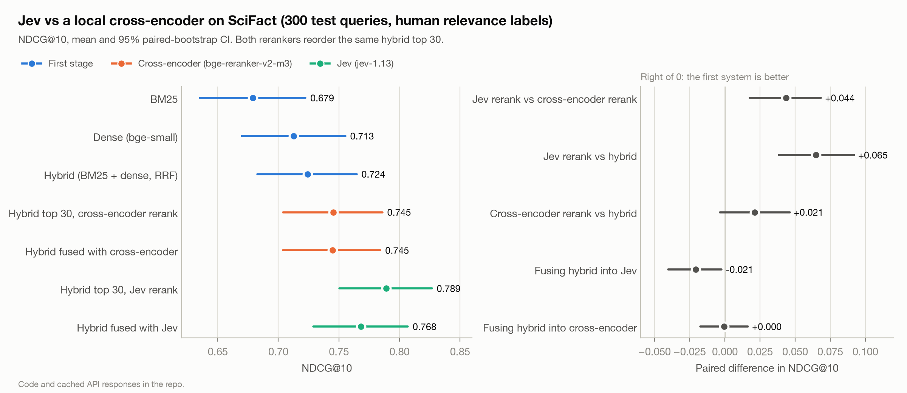
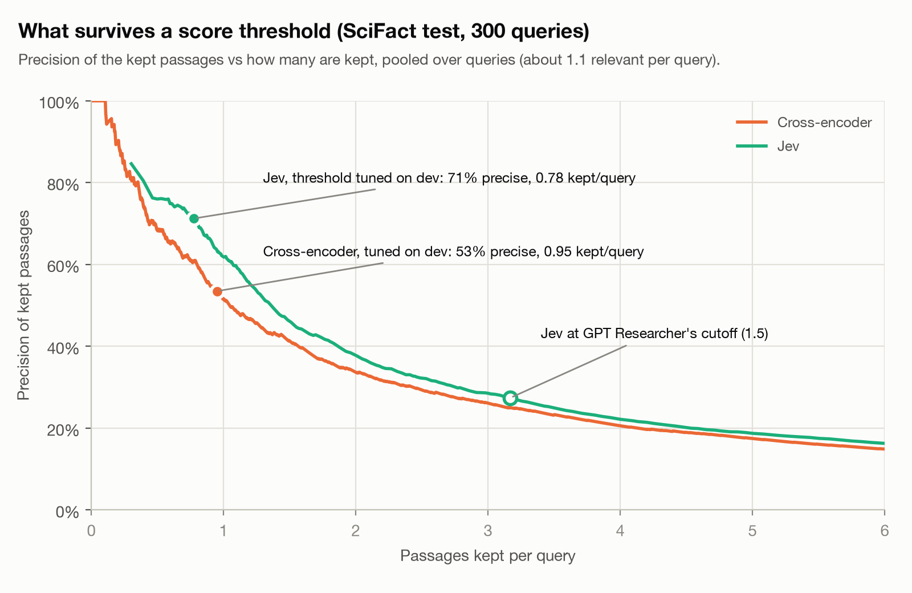

# Jev on a retrieval ladder (BEIR SciFact)

A small, reproducible check of where TypeSafe's Jev fits in a search pipeline. Jev takes text
plus typed questions and returns probabilities over the answers you define, with no generated
text. People use it as a reranker. This repo compares it with a free, local cross-encoder on a
benchmark with **human** relevance labels, so no LLM judge is involved.

This is a hands-on look at one dataset, not a benchmark. Not affiliated with TypeSafe.



## Results (SciFact test, 300 queries)

Mean with 95% paired-bootstrap CI (10,000 resamples over queries). Every reranker reorders the
same 30 candidates from the hybrid retriever. Those 30 hold 90.5% of the relevant documents
(hybrid Recall@30 = 0.905), which is the ceiling for any reranker here.

| System | NDCG@10 | MRR@10 | Recall@10 |
|---|---|---|---|
| BM25 | 0.679 [0.635, 0.722] | 0.643 | 0.808 |
| Dense, bge-small-en-v1.5 | 0.713 [0.670, 0.755] | 0.682 | 0.836 |
| Hybrid, RRF(BM25, dense) | 0.724 [0.683, 0.765] | 0.689 | 0.858 |
| Hybrid top 30, reranked by bge-reranker-v2-m3 | 0.745 [0.704, 0.786] | 0.717 | 0.857 |
| RRF(hybrid, cross-encoder) | 0.745 [0.704, 0.784] | 0.709 | 0.875 |
| **Hybrid top 30, reranked by Jev** | **0.789 [0.751, 0.827]** | **0.763** | **0.892** |
| RRF(hybrid, Jev) | 0.768 [0.729, 0.807] | 0.738 | 0.884 |

The per-system intervals overlap, so the paired differences are what to read:

| Paired difference, NDCG@10 | Mean [95% CI] |
|---|---|
| Jev rerank minus cross-encoder rerank | +0.044 [0.018, 0.068] |
| Jev rerank minus hybrid | +0.065 [0.038, 0.092] |
| Cross-encoder rerank minus hybrid | +0.021 [-0.004, 0.046] |
| RRF(hybrid, Jev) minus Jev rerank | -0.021 [-0.040, -0.002] |
| RRF(hybrid, cross-encoder) minus cross-encoder rerank | 0.000 [-0.017, 0.016] |
| RRF(hybrid, Jev) minus RRF(hybrid, cross-encoder) | +0.023 [0.008, 0.038] |

### Score thresholds



Each reranker's threshold was chosen on the dev split (max F1) and applied once to test.
Precision and recall are pooled over queries.

| Threshold | Precision | Recall | Passages kept per query |
|---|---|---|---|
| Jev, score >= 2.81 (of 3) | 0.712 | 0.490 | 0.78 |
| Cross-encoder, sigmoid score >= 0.828 | 0.535 | 0.451 | 0.95 |
| Jev, score >= 1.5 (GPT Researcher's default) | 0.274 | 0.767 | 3.17 |

At a matched budget of one kept passage per query, Jev's precision is 0.619 and the
cross-encoder's is 0.517.

## What this shows

1. On SciFact, Jev reranked better than bge-reranker-v2-m3, a strong open cross-encoder, by
   0.044 NDCG@10, and the paired CI excludes zero. The cross-encoder's own gain over the hybrid
   is not distinguishable from zero on this dataset.
2. Fusing the reranked list back with the hybrid (RRF) lowered Jev's score slightly and left the
   cross-encoder unchanged. An equal-weight fusion pulls a strong reranker toward a weaker
   first stage. The earlier evaluation that found fusion helping Jev reranked a first stage that
   was already close to Jev in quality.
3. Jev's scores give a usable cutoff: at about one passage per query they keep a cleaner set
   than the cross-encoder's. The cutoff is task-specific. GPT Researcher's 1.5, chosen for a
   different task, keeps three passages per query at 27% precision here, where queries have
   about 1.1 relevant documents.
4. Jev is not fully deterministic. Of 20 repeated calls, 4 returned the identical score; the
   mean absolute difference was 0.027 and the largest 0.09 on the 0-3 scale. The cached
   responses are what make these numbers reproducible.

## End to end: does the better ranking give better answers?

SciFact's real task is to decide whether the abstracts support a claim, contradict it, or say
nothing. The original release has those labels (BEIR's 300 test claims are SciFact's labeled
dev split: 124 SUPPORT, 64 CONTRADICT, 112 NOT_ENOUGH_INFO). Claude Haiku 5.5 read the
passages each pipeline returned and gave one verdict per claim, from the abstracts only
(effort `medium`, JSON schema output, prompt in [`ladder/verdict.py`](ladder/verdict.py)). The
prompt was fixed before the dev check and the test set was run once.

| Context handed to Claude | Accuracy [95% CI] | Evidence in context | Accuracy, NOT_ENOUGH_INFO claims | Input tokens per claim |
|---|---|---|---|---|
| Hybrid, top 3 | 0.787 [0.740, 0.833] | 0.910 | 0.759 | 2,139 |
| Cross-encoder, top 3 | 0.790 [0.743, 0.837] | 0.926 | 0.759 | 2,338 |
| Jev, top 3 | 0.777 [0.730, 0.823] | 0.957 | 0.679 | 2,116 |
| Jev, score >= 2.81 (0.78 passages per claim) | 0.780 [0.733, 0.827] | 0.766 | 0.884 | 887 |
| The cited abstracts (oracle) | 0.833 [0.790, 0.873] | 1.000 | 0.830 | 1,066 |

"Evidence in context" is the share of the 188 claims with evidence whose context includes an
abstract that holds it. Majority-class accuracy is 0.413.

| Paired accuracy difference | All claims | Claims with evidence | NOT_ENOUGH_INFO claims |
|---|---|---|---|
| Jev minus cross-encoder | -0.013 [-0.057, +0.027] | +0.027 [-0.027, +0.080] | -0.080 [-0.143, -0.018] |
| Jev threshold minus Jev top 3 | +0.003 [-0.047, +0.053] | -0.117 [-0.181, -0.059] | +0.205 [+0.134, +0.286] |
| Cited abstracts minus Jev top 3 | +0.057 [+0.013, +0.100] | +0.000 [-0.048, +0.048] | +0.152 [+0.071, +0.232] |

1. The ranking gain does not reach the answer. All three top-3 pipelines are within 1.3 points
   of each other, and no paired difference excludes zero.
2. Two effects cancel. Jev puts the evidence in front of Claude more often (0.957 vs 0.926),
   and on claims with evidence Claude does as well with Jev's top 3 as with the cited
   abstracts. On claims with no evidence, Jev's passages more often lead Claude to SUPPORT or
   CONTRADICT, 8 points worse than the cross-encoder's, CI excluding zero. Jev's top 3 holds
   the cited abstract no more often than the cross-encoder's (0.509 vs 0.527 of these claims),
   so the extra errors come from other passages that read like evidence.
3. The threshold trades the same thing the other way: right more often when there is nothing to
   find, wrong more often when it drops the evidence. Overall accuracy is the same as Jev's top
   3 with 58% fewer input tokens.
4. Haiku 5.5's biosecurity classifier refused 3 to 6 claims per pipeline (virology and drug
   resistance claims, refused whatever the context). Refusals count as wrong answers.

## Method

- **Data.** BEIR SciFact: 5,183 abstracts, 300 test claims with human qrels (1.13 relevant per
  query, binary). Dev split: 100 claims sampled (seed 13) from the train qrels. All choices
  (rubric wording, both thresholds) were made on dev and frozen in
  [`config/frozen.json`](config/frozen.json) before Jev saw a test query.
- **First stage.** `bm25s` with Lucene k1=1.2, b=0.75, English stopwords and stemming.
  `BAAI/bge-small-en-v1.5` with its query instruction, exact cosine. Hybrid is RRF with k=60.
  BM25 (0.679) and dense (0.713) match published SciFact numbers.
- **Cross-encoder.** `BAAI/bge-reranker-v2-m3` through sentence-transformers, fp16 as in the
  model card, no truncation (longest pair 2,298 tokens, limit 8,192). A first run truncated at
  512 tokens in fp32 scored 0.744; its outputs are kept in `runs/ce_fp32_512/`.
- **Jev.** `typesafe/jev-1.13-20260917` via OpenRouter's TypeSafe-compatible endpoint
  (`/api/v1/systemone`), one request per (claim, passage) pair with one `score` question:

  ```json
  {"type": "score",
   "instructions": "How useful is this passage as scientific evidence for checking the claim?",
   "criteria": ["Unrelated to the claim",
                "Same topic, but says nothing about whether the claim is true",
                "Indirect or partial evidence about the claim",
                "Directly provides evidence that supports or refutes the claim"]}
  ```

  The ranking signal is Jev's `score`, the probability-weighted level from 0 to 3. On dev this
  rubric scored 0.768 NDCG@10 and GPT Researcher's generic question-answering rubric scored
  0.762.
- **Statistics.** Paired bootstrap over test queries, 10,000 resamples, seed 13. No correction
  for the six comparisons.

## Cost and latency

| | Jev | Cross-encoder |
|---|---|---|
| Test run | 9,000 calls, $0.283 ($0.00094 per query of 30 passages) | local GPU, no API cost |
| Mean input tokens per call | 750 | |
| Latency | 129 ms p50, 209 ms p95 per call via OpenRouter; calls run in parallel | 319 ms p50, 661 ms p95 per query of 30 pairs on an NVIDIA A10G |
| Total spend for the project | $0.467 (dev tuning, test, checks) | one ~12 minute GPU run |

The end-to-end check cost $0.39 in Claude Haiku 5.5 calls (dev and test, about $0.0003 per
claim per pipeline).

The latencies are measured on different kinds of setups (a hosted API against one rented
GPU), so they are indicative only.

## Limitations

- One dataset of short scientific claims, 300 test queries, sparse binary labels. Unlabeled
  relevant documents make threshold precision a lower bound for both rerankers.
- One rubric family, written with SciFact's claims in mind (the generic rubric was close on dev).
- Pointwise scoring only. Several Jev wrappers score many passages in one request; that was
  not tested.
- Either model may have seen SciFact during training; this cannot be checked for Jev.
- Jev's run-to-run variation is not included in the confidence intervals.
- The end-to-end check uses one reader (Claude Haiku 5.5), one prompt, and one sample per call;
  Haiku 5.5 does not accept a temperature, so its run-to-run variation is not in the CIs either.

## Reproduce

```bash
uv sync
uv run python scripts/00_prepare.py      # download SciFact, build the dev split
uv run python scripts/01_retrieve.py     # BM25, dense, hybrid
uv run python scripts/02_rerank_ce.py    # cross-encoder (a CUDA GPU is recommended)
uv run python scripts/03_jev_dev.py      # Jev on dev, freezes config/frozen.json
uv run python scripts/04_jev_test.py     # Jev on test and the determinism check
uv run python scripts/05_evaluate.py     # bootstrap CIs -> results/results.json
uv run python scripts/06_plot.py         # figures/
uv run python scripts/08_verdicts.py dev # Claude verdicts, prompt check on dev
uv run python scripts/08_verdicts.py test
uv run python scripts/09_evaluate_verdicts.py  # -> results/verdicts.json
```

Every Jev response is cached in `cache/jev/` and every Claude response in `cache/claude/`, so
these steps run without API keys or cost. A new request needs `OPENROUTER_API_KEY=...` or
`ANTHROPIC_API_KEY=...` in a `.env` file at the repo root. All numbers in this README come from
`results/results.json` and `results/verdicts.json`.

## Related

- [zhuyansen/jev-search-rerank-eval](https://github.com/zhuyansen/jev-search-rerank-eval):
  Jev reranking on a skills catalog with LLM labels, including a measurement of judge bias.
- [hev/jev-rerank](https://github.com/hev/jev-rerank): reports Jev at 0.768 NDCG@10 on SciFact
  against hosted rerankers.
- [GPT Researcher context filter](https://docs.gptr.dev/docs/gpt-researcher/gptr/context-filter):
  the source of the 1.5 threshold.
